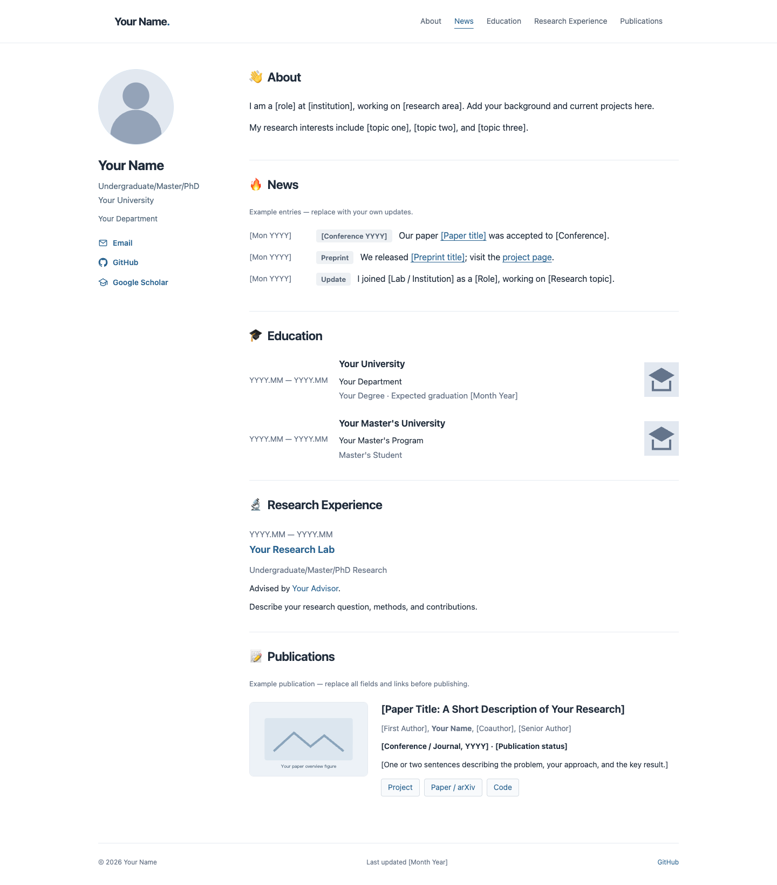
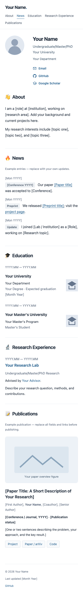

# Academic Homepage Template

## 页面预览 / Preview

Desktop / 桌面端



Mobile / 手机端




[中文](#中文) | [English](#english)

## 中文

通用学术个人主页模板，HTML + CSS + 原生 JavaScript，无需安装依赖或构建。所有人物与机构内容均为占位示例，图片为通用 SVG。

## 快速开始

下载本仓库，直接打开 `index.html`，或运行：

```sh
python3 -m http.server 8000 --bind 127.0.0.1
```

浏览器访问 http://127.0.0.1:8000 。

## 定制

- `index.html`：替换 Your Name、身份、院系、学校、教育及研究经历、日期、About、News、Publications 和页脚更新时间。
- 将 `your-username`、`you@example.com`、`example.com` 替换为自己的 GitHub、邮箱及机构链接。
- `assets/images/avatar.svg`：替换头像，同时更新 HTML 中图片路径、alt 与宽高。
- `assets/images/institution.svg`：替换学校标志，并更新 alt。
- `style.css`：修改颜色、字体、布局和响应式样式。
- `script.js`：自动版权年份与当前栏目导航。
- 需要 CV 或论文时，新建 `assets/files`，放入文件后添加相对路径链接。

## 发布

将根目录文件及 assets 上传到自己的公开仓库，在 GitHub Settings → Pages 中选择发布分支及根目录。项目使用相对路径，可用于项目站点。保留 `.nojekyll`。

发布前搜索所有占位符，检查链接、图片、手机布局和键盘导航。不要提交密钥或私人文件。

## 许可

代码与通用 SVG 使用 MIT License。自行添加的照片、校徽、论文等素材需自行确认授权。

身份占位为 `Undergraduate/Master/PhD`，请按实际阶段保留一项。第二段教育经历为硕士经历，需填写硕士院校、专业与起止日期。

---

## English

A reusable academic homepage template built with HTML, CSS, and vanilla JavaScript. No dependencies or build step are required. All personal and institutional content is placeholder text. Images are generic SVG assets.

### Quick start

Download this repository and open `index.html` directly, or run:

```sh
python3 -m http.server 8000 --bind 127.0.0.1
```

Visit http://127.0.0.1:8000 in your browser.

### Customization

- `index.html`: replace Your Name, role, department, institutions, education and research experience, dates, About, News, Publications, and the footer's last-updated date.
- The role placeholder is `Undergraduate/Master/PhD`; keep the stage that applies to you. The second education entry is a master's degree: fill in your institution, program, and dates.
- Replace `your-username`, `you@example.com`, and `example.com` with your GitHub username, email address, and institutional links.
- `assets/images/avatar.svg`: replace the avatar and update its HTML path, alt text, width, and height.
- `assets/images/institution.svg`: replace the institution logo and update its alt text.
- `style.css`: customize colors, fonts, layout, and responsive styles.
- `script.js`: updates the copyright year and highlights the current navigation section.
- To add a CV or papers, create `assets/files`, add your documents, and link to them using relative paths.

### Deployment

Upload the root files and `assets` directory to your own public repository. In GitHub **Settings → Pages**, select the publishing branch and root directory. Relative paths support project sites. Keep `.nojekyll`.

Before publishing, search for all placeholders and check links, images, mobile layout, and keyboard navigation. Do not commit secrets or private files.

### License

The code and generic SVG assets use the [MIT License](LICENSE). Check permissions for any photos, institution logos, papers, or other materials you add.

## News、论文和 Scholar 模板 / News, publications, and Scholar templates

- Google Scholar：将 `YOUR_SCHOLAR_ID` 替换为个人主页 URL 中的 user 参数。
- News：复制 `.news-list` 中的 `li`，填写月份年份、标签、动态及链接，按时间倒序排列。
- Publications：复制 `.publication`，替换标题、作者（自己的名字加粗）、会议或期刊、年份、发表状态、摘要和 Project / Paper / Code 链接。删除没有资源的按钮。
- 将 `assets/images/publication.svg` 换为论文概览图，更新路径、alt 和原始宽高。示例均为占位内容，上线前删除提示并替换。

- Google Scholar: replace `YOUR_SCHOLAR_ID` with the user parameter from your profile URL.
- News: duplicate a `li` inside `.news-list`; update the month/year, tag, announcement, and links. Keep newest entries first.
- Publications: duplicate `.publication`; fill in the title, authors (bold your name), venue, year, status, summary, and Project / Paper / Code links. Remove unavailable resource buttons.
- Replace `assets/images/publication.svg` with your paper overview figure and update its path, alt text, and original dimensions. Remove example notices and replace all placeholders before publishing.
